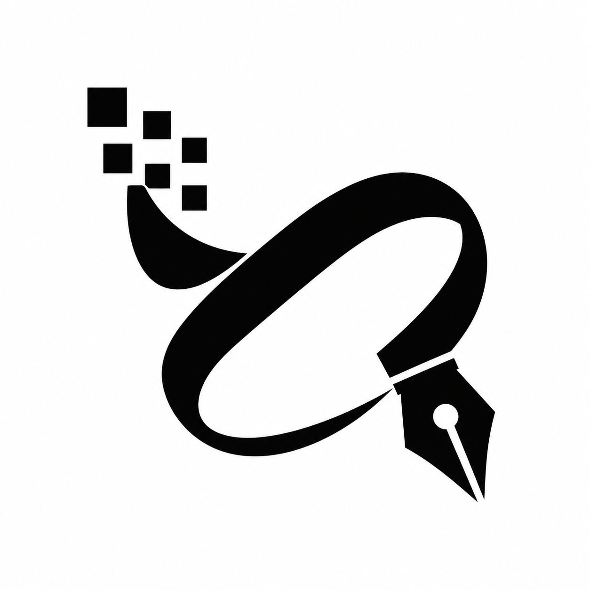

<div align="center">
  <picture>
    <source media="(prefers-color-scheme: dark)" srcset=".github/assets/openvector-logo-reversed.png">
    
  </picture>
  <h1>openvector</h1>
  <p>raster-to-vector conversion in the browser, on the desktop, in the terminal, and in node.js.</p>
  <p>
    <a href="https://github.com/Microck/openvector/releases/latest"><picture><source media="(prefers-color-scheme: dark)" srcset="https://shieldcn.dev/badge/release-0.1.7.svg?variant=secondary&amp;size=xs&amp;logo=false&amp;mode=dark"></picture></a>
    <a href="https://www.npmjs.com/package/openvector"><picture><source media="(prefers-color-scheme: dark)" srcset="https://shieldcn.dev/npm/dt/openvector.svg?variant=secondary&amp;size=xs&amp;logo=false&amp;mode=dark"></picture></a>
    <a href="https://github.com/Microck/openvector/actions/workflows/source.yml"><picture><source media="(prefers-color-scheme: dark)" srcset="https://shieldcn.dev/github/ci/Microck/openvector.svg?workflow=source.yml&amp;branch=main&amp;variant=secondary&amp;size=xs&amp;logo=false&amp;mode=dark"></picture></a>
    <a href="LICENSE"><picture><source media="(prefers-color-scheme: dark)" srcset="https://shieldcn.dev/badge/license-MIT.svg?variant=secondary&amp;size=xs&amp;logo=false&amp;mode=dark"></picture></a>
  </p>
</div>

---

openvector turns png, jpeg, bmp, gif, and tiff images into editable vectors.
one rust engine powers the web editor, native desktop app, cli, and node-api library.
tracing always runs on your device: the web editor works in the browser tab and never uploads your images.

[web editor](https://openvector.app/editor/) | [build](docs/building.md) | [cli and node api](docs/usage.md) | [changelog](CHANGELOG.md) | [verification](docs/verification.md) | [release runbook](docs/release-runbook.md)

## what it does

- automatic tracing, manual palettes, segmentation editing, and background removal.
- svg, pdf, eps, ai, dxf, and emf export, plus rasterized png, jpeg, bmp, and tiff output.
- batch conversion, saved advanced profiles, and recent basic settings.
- a native gpui desktop interface, also available in the browser, with the same engine available to scripts.

## use it in the browser

open [openvector.app/editor](https://openvector.app/editor/). there is nothing to install and no account.

it is the same gpui editor as the desktop app, compiled to webassembly. images stay in the
tab's memory and are never uploaded; exports download straight to your device. the editor
needs webgl2 and a browser with shared webassembly memory.

to build or self-host it, see [web/README.md](web/README.md).

## download

download the desktop app from [github releases](https://github.com/Microck/openvector/releases/latest).
each package includes its third-party notices.

### v0.1.7

| platform | package | run |
| --- | --- | --- |
| macos, apple silicon | [dmg](https://github.com/Microck/openvector/releases/download/v0.1.7/openvector-0.1.7-macos-arm64.dmg) | open the disk image and drag OpenVector to Applications |
| macos, intel | [dmg](https://github.com/Microck/openvector/releases/download/v0.1.7/openvector-0.1.7-macos-x64.dmg) | open the disk image and drag OpenVector to Applications |
| linux, amd64 | [AppImage](https://github.com/Microck/openvector/releases/download/v0.1.7/openvector-0.1.7-linux-amd64.AppImage), [Flatpak](https://github.com/Microck/openvector/releases/download/v0.1.7/openvector-0.1.7-linux-amd64.flatpak), or [tar.gz](https://github.com/Microck/openvector/releases/download/v0.1.7/openvector-0.1.7-linux-amd64.tar.gz) | see the Linux instructions below |
| linux, arm64 | [AppImage](https://github.com/Microck/openvector/releases/download/v0.1.7/openvector-0.1.7-linux-arm64.AppImage), [Flatpak](https://github.com/Microck/openvector/releases/download/v0.1.7/openvector-0.1.7-linux-arm64.flatpak), or [tar.gz](https://github.com/Microck/openvector/releases/download/v0.1.7/openvector-0.1.7-linux-arm64.tar.gz) | see the Linux instructions below |
| windows 10 and 11, x64 | [installer](https://github.com/Microck/openvector/releases/download/v0.1.7/openvector-0.1.7-windows-x64-Setup.exe) or [portable zip](https://github.com/Microck/openvector/releases/download/v0.1.7/openvector-0.1.7-windows-x64-portable.zip) | run the installer, or extract the whole zip and open `openvector-gui.exe` |

on linux, make the AppImage executable and run it, or install the Flatpak with
`flatpak install --user ./openvector-0.1.7-linux-<arch>.flatpak` and launch it
with `flatpak run dev.micr.openvector`. use the file chooser in the Flatpak to
open and save host files. for the tarball, extract it and run the
`openvector-gui` executable inside.

macos packages are developer id-signed, notarized, and stapled.

windows executables are unsigned; the portable package needs no installation
but still saves preferences in the normal per-user location.

linux packages target ubuntu 24.04 with glibc 2.39 and were tested with X11.
the required desktop libraries are in the [build guide](docs/building.md).
wayland remains unverified. the release includes matching source and SHA-256 checksums.

these checks do not establish exact parity or coverage of every input.
v0.1.2 improves text-field accessibility, but full screen-reader support remains unverified.
see the [release coverage limits](https://github.com/Microck/openvector/releases/tag/v0.1.7)
and [verification and known limits](docs/verification.md).

## install the cli and node library

the cli and node library are published as [openvector](https://www.npmjs.com/package/openvector).

the npm package includes native binaries for linux amd64 and arm64, windows x64,
and macos apple silicon and intel. use node.js 22.19 or later. windows arm64
machines need x64 node.js; native arm64 windows and alpine/musl packages are not
included. linux packages are built and tested on ubuntu 24.04.

```sh
npm install openvector
npx openvector vectorize logo.png --output logo.svg
```

for a global cli installation, run `npm install -g openvector`, then `openvector --help`.

the desktop app is a separate download. npm installation does not need rust
or download additional native binaries.

## build from source

use node.js 22.19 or later, npm, rust with its `rust-docs` component, git, and a c
compiler/linker. native packaging also needs platform-specific toolchain notices.
the [build guide](docs/building.md) covers supported targets, cross-compilation,
linux libraries, and windows node-api linking.

```sh
git clone https://github.com/Microck/openvector.git
cd openvector
npm ci
npm run build
node bin/openvector.mjs --help
```

`npm run build` produces the cli and node addon for the selected platform.
it does not build the desktop app.

```sh
cargo run --manifest-path rust/Cargo.toml --locked -p openvector-gui -- logo.png
```

the desktop app needs a graphical session. use `OPENVECTOR_PREFERENCES` to select a
separate preferences file when testing.

## convert an image

```sh
node bin/openvector.mjs vectorize logo.png --output logo.svg
node bin/openvector.mjs vectorize logo.png --output logo.pdf
mkdir vectors
node bin/openvector.mjs batch first.png second.jpg --format svg --output-dir vectors
```

the output suffix selects the format. existing outputs require an explicit
replacement option. processing does not rewrite the source image.

## use it from node.js

after installing the npm package or building the native addon:

```js
import { readFileSync } from 'node:fs';
import { CoreSession } from 'openvector';

const document = new CoreSession().createDocument();
document.setSource(readFileSync('logo.png'), 'logo.png');
document.runAutomatic({ extension: '.png' });
// saveVector creates a new file and never overwrites an existing path.
const saved = document.saveVector('logo.svg', { layout: 'cutouts' });
if (saved.status !== 0 || saved.error) {
  throw new Error(saved.error?.message ?? `Export failed: ${saved.status}`);
}
```

calls are synchronous. the [api guide](docs/usage.md) covers progress, cancellation,
batches, editing, snapshots, and profile storage. the package never downloads a
binary or falls back to the javascript reference implementation on import.

## development

```sh
npm run test:smoke
```

that command runs small reference checks and independently authored tests included
in the default checkout. it is also the test scope of [GitHub Actions source CI](docs/ci.md),
not a claim that the full native or desktop suites pass. see
[development](docs/development.md) and [test fixtures](docs/test-fixtures.md) for
the broader checks and their private fixture corpus.

| directory | contents |
| --- | --- |
| `rust/crates/openvector` | shared tracing engine |
| `rust/crates/openvector-gui` | native desktop app |
| `rust/crates/openvector-cli` | cli |
| `rust/crates/openvector-node`, `npm/` | node-api binding and public declarations |
| `web/` | browser build of the editor, landing page, and hosting config |
| `src/`, `gui/` | development reference implementation, models, and HTTP test host |
| `test/`, `docs/` | tests, fixtures, usage guides, and behavioral contracts |

## license

application code is [mit licensed](LICENSE). third-party code, fonts, and icons
retain their own licenses. packages must include their generated notices and
editable source where required. qt-derived code has lgpl requirements; review the
[distribution notes](docs/building.md) before a public binary release.

openvector is an independent project and is not affiliated with vector magic.
