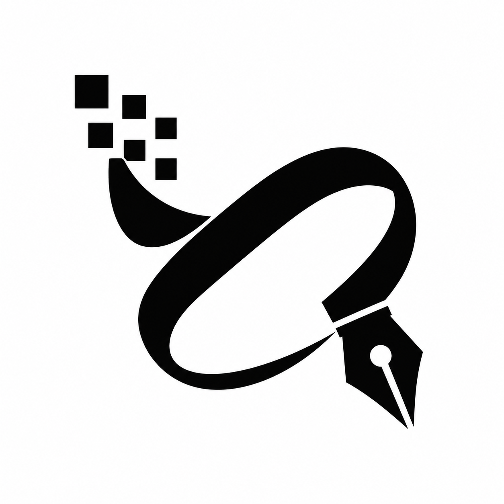

<div align="center">
  
  <h1>openvector</h1>
  <p>raster-to-vector conversion for the desktop, terminal, and node.js.</p>
  <p>
    <a href="https://github.com/Microck/openvector/releases/latest"></a>
    <a href="docs/ci.md"></a>
    <a href="LICENSE"></a>
  </p>
</div>

---

openvector turns png, jpeg, bmp, gif, and tiff images into editable vectors.
one rust engine powers the native desktop app, cli, and node-api library.
it runs independently and does not require vector magic or a network service.

[build](docs/building.md) | [cli and node api](docs/usage.md) | [verification](docs/verification.md) | [release runbook](docs/release-runbook.md)

## what it does

- automatic tracing, manual palettes, segmentation editing, and background removal.
- svg, pdf, eps, ai, dxf, and emf export, plus rasterized png, jpeg, bmp, and tiff output.
- batch conversion, saved advanced profiles, and recent basic settings.
- a native gpui desktop interface, with the same engine available to scripts.

## download

[the latest private release](https://github.com/Microck/openvector/releases/latest)
includes the desktop app and its third-party notices. sign in with an account that
has access to this repository.

| platform | package | run |
| --- | --- | --- |
| windows 10, x64 | [zip](https://github.com/Microck/openvector/releases/download/v0.0.0/openvector-0.0.0-windows-x64.zip) | extract the whole archive, then open `openvector-gui.exe` |
| linux, arm64 | [tar.gz](https://github.com/Microck/openvector/releases/download/v0.0.0/openvector-0.0.0-linux-arm64.tar.gz) | extract, then run `./openvector-gui-linux/openvector-gui` |

linux needs glibc 2.39 or later and the desktop libraries listed in the
[build guide](docs/building.md). the windows executable is unsigned. macos and
other architectures currently require a source build. there is no published npm package.

these are the tested desktop builds, not a claim of full equivalence with vector
magic or coverage of every input. see [verification and known limits](docs/verification.md).

## build from source

use node.js 22.19 or later, npm, rust with its `rust-docs` component, git, and a c
compiler/linker. native packaging also needs platform-specific toolchain notices.
the [build guide](docs/building.md) covers supported targets, cross-compilation,
linux libraries, and the windows node-api linker input.

```sh
git clone https://github.com/Microck/openvector.git
cd openvector
npm ci
npm run build
node bin/openvector.mjs --help
```

repository access requires authentication. `npm run build` produces the cli and
node addon for the selected platform. it does not build the desktop app.

```sh
cargo run --manifest-path rust/Cargo.toml --locked -p openvector-gui -- logo.png
```

the desktop app needs a graphical session. use `OPENVECTOR_PREFERENCES` to select a
separate preferences file when testing.

## convert an image

```sh
node bin/openvector.mjs vectorize logo.png --output logo.svg
node bin/openvector.mjs vectorize logo.png --output logo.pdf
mkdir vectors
node bin/openvector.mjs batch first.png second.jpg --format svg --output-dir vectors
```

the output suffix selects the format. existing outputs require an explicit
replacement option. processing does not rewrite the source image.

## use it from node.js

after building the native addon:

```js
import { readFileSync } from 'node:fs';
import { CoreSession } from 'openvector';

const document = new CoreSession().createDocument();
document.setSource(readFileSync('logo.png'), 'logo.png');
document.runAutomatic({ extension: '.png' });
const saved = document.saveVector('logo.svg', { layout: 'cutouts' });
if (saved.status !== 0 || saved.error) {
  throw new Error(saved.error?.message ?? `Export failed: ${saved.status}`);
}
```

calls are synchronous. the [api guide](docs/usage.md) covers progress, cancellation,
batches, editing, snapshots, and profile storage. the package never downloads a
binary or falls back to the javascript reference implementation on import.

## development

```sh
npm run test:smoke
```

that command runs the small reference checks included in the default checkout.
it is also the test scope of [raft source ci](docs/ci.md), not a claim that the full
native or desktop suite passed. see [development](docs/development.md) and [test fixtures](docs/test-fixtures.md)
for the full suite and its external fixture corpus.

| directory | contents |
| --- | --- |
| `rust/crates/openvector` | shared tracing engine |
| `rust/crates/openvector-gui` | native desktop app |
| `rust/crates/openvector-cli` | cli |
| `rust/crates/openvector-node`, `npm/` | node-api binding and public declarations |
| `src/`, `gui/` | development reference implementation and browser preview |
| `test/`, `docs/` | tests, fixtures, usage guides, and behavioral contracts |

## license

application code is [mit licensed](LICENSE). third-party code, fonts, and icons
retain their own licenses. packages must include their generated notices and
editable source where required. qt-derived code has lgpl requirements; review the
[distribution notes](docs/building.md) before a public binary release.

openvector is an independent project and is not affiliated with vector magic.
