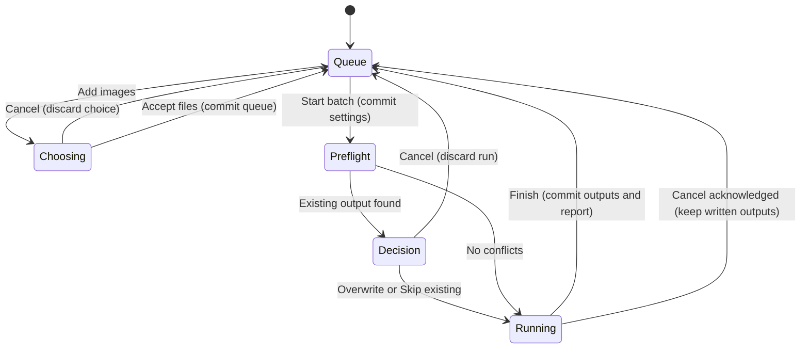

# The batch

## Summary

Batch converts a queue of source files into vector files in one export folder.
The toolbar switches between Batch and Single image. Batch shows a file list,
processing settings, an export folder and Start batch. A single-image result is
not required. Switching workspaces is unavailable while processing.

## The simple case

Choose Batch and Add images. Accept several readable images. Choose the export
folder after adding the files, choose SVG and press Start batch. Wait for the
worker to finish. Each successful row shows its written output path, and a
summary counts converted, failed and skipped files. Show Export Folder opens
the output directory. The queue remains for another run.

## The interaction, event by event

### Starting

Add images opens a native chooser with multiple selection. Accepted paths enter
in chooser order. Identical path strings already queued are rejected with an
Already in queue message; other accepted paths still enter the queue.
Each row gets a source thumbnail or a decode error and a Preview control.
Adding sources preserves the chosen export folder.

Select toggles row selection. Remove selected deletes selected entries from the
queue. A row's Remove deletes that row when unselected; when selected, it removes
all selected rows. Clear all empties the queue. These actions leave files on disk.
Selection is for removal, not choosing which files Start batch processes.

### Ending at once

Canceling either native chooser keeps its current queue or folder.
Start batch is disabled with an empty queue. Switching back to Single image
keeps the queue for the next visit. No files are written by queue editing.

### Becoming extended

If the single image has manual edits, Start batch asks before replacing it.
Cancel keeps those edits and does not start conversion.

After confirmation, Start batch captures the current processing settings and export options, clears
the previous report and selection, and disables queue changes. It plans output
names for every entry, regardless of selection. Matching stems, including case-only differences, receive numeric
suffixes within this run. Existing outputs trigger one Replace existing batch
outputs? dialog listing the paths.

Overwrite permits replacement only for the existing paths listed in the dialog. Skip existing processes only outputs
that did not exist at preflight. Cancel abandons the run before conversion.
If every output exists and Skip existing is chosen, nothing is converted.
The supported batch formats are SVG, EPS, PDF, AI and DXF.

### While extended

The footer reports the file number and processing stage. The batch reads and
processes files in queue order. Queue selection, removal, folder choices,
settings changes and workspace switching are unavailable until completion.
Cancel requests a stop. Already written files remain on disk.
The detailed log and per-row outcome report arrive when the run finishes,
including when cancellation returns a partial report.

### Finishing

The queue becomes editable again. A row can report written, failed-load,
failed-save, skipped or pending. Pending means the run stopped before that file
finished; it is not included in the converted, failed or skipped totals.
Unreadable images and reported save failures show an error and allow later
queue entries to continue. A processing error can stop the run instead.
No batch-wide Undo exists. Starting again retries the full queue with a new
output-existence check; Skip existing can preserve earlier successes.
The first attempted batch load resets the shared single-image document before decoding.
After the replacement confirmation, even a failed first load can discard its previous edits. The shared document
becomes the last batch document reached.
Returning to Single image does not restore the pre-batch source or edits.

## Modifiers

| Variant | Set at the start | Changed while extended |
| --- | --- | --- |
| Selected rows | All entries still process; start clears selection. | Selection controls are disabled. |
| Basic or Advanced controls | Captured settings apply to the run. | Settings controls are disabled. |
| Saved profile | Use applies its settings to the batch before start. | Profile actions are disabled. |
| Existing outputs | One overwrite decision covers all conflicts. | Files appearing after preflight stay unchanged and produce a save failure. |
| Same source stem | Planned names get suffixes within the queue. | No effect. |
| EMF selected in Single image | Entering Batch changes format to SVG. | No effect. |
| Keyboard modifiers | No alternate batch processing behavior. | No effect. |

## Cancel and interrupt

| Event | Before extended | While extended |
| --- | --- | --- |
| Explicit cancel | Chooser Cancel keeps the queue or folder. | Cancel requests stopping; overwrite-dialog Cancel stops before conversion; completed writes remain. |
| Another command | Queue, folder and settings commands change the next run. | Conflicting controls are disabled; the overwrite dialog owns its decision. |
| Focus or process loss | Focus loss does not start a batch. | Focus loss does not request cancellation; process exit loses session queue/report and does not undo disk writes. |
| Target changes outside the app | Conversion reads the file when its turn arrives. | Read/save can fail; newly appearing output paths stay unchanged and report a save failure. |
| Input device or modifier changes | Native selection accepts pointer or keyboard input. | An accepted queue and captured settings do not change. |

## Interactions with other systems

**Files and permissions.** Sources need read access and outputs need write access.
The batch does not create a missing export directory. Clear and Remove affect
queue membership only. External changes can invalidate an earlier preview.

**History and undo.** Batch output has no Undo. Batch previews are separate from
recent-image previews. Running batch replaces the shared single-image document.

**Busy and modal states.** The queue and settings lock for the run, including
while it waits for an overwrite decision. The overwrite dialog offers Cancel,
Skip existing and Overwrite.

**Offline operation.** Files, conversion and reports are local.

**Feedback.** Each row shows its full source path, a preview when available and
its latest outcome after completion. A repaired source refreshes its preview
when a later run reads it; skipped files retain their previous preview.

**Preferences.** Single-image and batch processing selections have separate
stored settings. Export options and format are shared. The chosen export folder
persists separately. Queue membership and previews last only for the session.

## Edge cases

- An unselected queue still processes all files.
- A duplicate path does not add a second row. Path aliases can remain separate.
- Case-only stem differences receive distinct planned names.
- Files created by another process after preflight are preserved.
- Adding sources leaves the chosen export folder unchanged.
- A conversion can fail before a complete per-row report arrives.
- A canceled run may show pending rows and totals smaller than queue length.

## Open questions and verification

- The four static findings now have fixes and automated checks.
  See [fixes and verification limits](verification/batch.md#static-review-findings).
  Packaged Windows batch interaction remains to be verified.
- Verify keyboard reachability, long paths, dialog focus and scrolling on Windows.
- Verify individual conversion errors, partial reports, retry and permission errors.

Baseline: `e794628c8ea3fbcfd4903e55c95ac29894846715`, with the current GUI QA changes.
The Linux and Windows batch queue and runner suites each passed all eight tests. GUI workflow
tests cover folder preservation and replacement confirmation. Windows batch
interaction remains pending.
