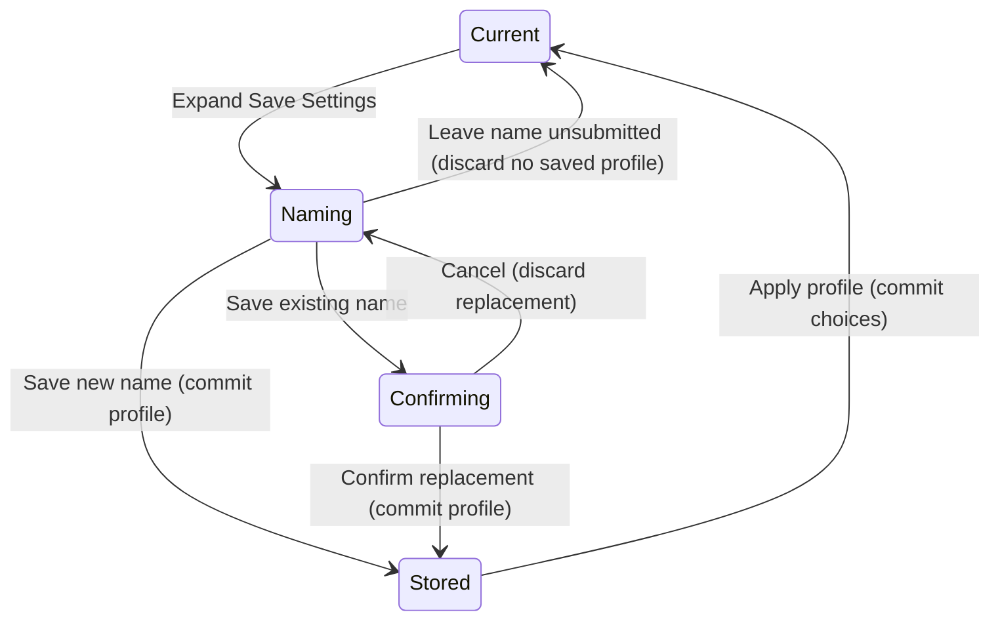

# Settings and history

## Summary

OpenVector remembers processing and export choices. Recent images and folders
help reopen local files. Recent Basic Settings reuse completed choices. Saved
Advanced Settings store named processing profiles. These lists are different
from a saved image or an editable project.

## The simple case

Finish an advanced conversion, expand Save Settings on Export, enter a meaningful
name and choose Save. On a later image, expand Saved Advanced Settings on the mode
page and choose the saved profile. Play enters the guided workflow; Fast forward
runs through processing. In Batch, Use applies a profile to batch settings.

## The interaction, event by event

### Starting

Open a disclosure to see its controls. Recent images and recent folders live on
Load. Recent basic and saved advanced settings live on the mode page. Advanced
Export provides the naming control; Batch also provides profile management.

### Ending at once

Collapsing a list does not delete its entries. Canceling a rename or replacement
dialog does not accept the proposed operation. Deleting a history entry is not
deleting a source file from disk.

### Becoming extended

Typing changes a draft name. Saving, renaming, deleting or applying a profile uses
its corresponding control. A replacement or deletion can require confirmation.

### While extended

Text fields own typed input. Enter in the inline name field submits Save. Dialog
fields and confirmation controls must keep keyboard focus inside the active form.
Processing controls become unavailable while an applied profile is running.

### Finishing

Saved profiles persist independently of the source. Applying a profile updates
processing choices and may start work. A persistence failure must appear as an
error rather than a successful save. Corrupt stored profiles produce a startup
error with their path and recovery guidance; the file is not silently replaced.

## Modifiers

| Variant | Set at the start | Changed while extended |
| --- | --- | --- |
| Single image | Uses its selected processing settings. | Completed choices can update recent basic settings. |
| Batch | Has separate processing choices. | Use applies the profile to the batch. |
| Existing name | Saving can replace an existing profile after confirmation. | Cancel keeps the previous saved entry. |
| Recent source missing | The stored entry remains a path to a file. | Open reports failure and retains the current document. |
| Keyboard | Enter saves the inline settings name. | Typed text must not trigger viewer shortcuts. |

## Cancel and interrupt

| Event | Before extended | While extended |
| --- | --- | --- |
| Explicit cancel | Collapsing a disclosure does not delete anything. | Cancel dismisses a confirmation without accepting it. |
| Another command | Select the relevant list or profile action. | Busy and modal rules restrict conflicting commands. |
| Focus or process loss | Focus change is not a Save. | Unsaved name text is not a persisted profile. |
| Target changes outside the app | Stored profile files can become unreadable. | Persistence errors must be reported; no silent repair is promised. |
| Input device or modifier changes | Pointer and keyboard reach the same controls. | Text fields own text while focused. |

## Interactions with other systems

**Files and permissions.** Preferences and profiles require a writable state
location. Reset does not delete source images or exported files.

**History and undo.** Profile management is separate from segmentation Undo.
Recent images are references to sources, not recoverable document snapshots.

**Busy and modal states.** Profile replay can start processing. Confirmations must
be resolved before ordinary controls become available again.

**Offline operation.** Profiles and history are local and need no account.

**Feedback.** Lists show saved names. Errors belong in the footer. Destructive
reset explains which lists and choices it clears before acceptance.

**Preferences.** The QA instance uses a dedicated preferences path and sibling
profiles file. A restart should restore persisted choices without importing the
user's separate manual-test settings.

## Edge cases

- Reusing a name requires a clear replacement decision.
- Empty names, spaces and non-ASCII names need actual validation checks.
- Reset application is broader than starting another image. Read its confirmation.
- A missing recent file must not discard a working result.
- Clearing recent lists must not remove their underlying files.

## Open questions and verification

The profile, reset and restart paths still require candidate runtime checks.
Source reviewed: `vector-magic-re` commit `e794628c8ea3fbcfd4903e55c95ac29894846715`.
