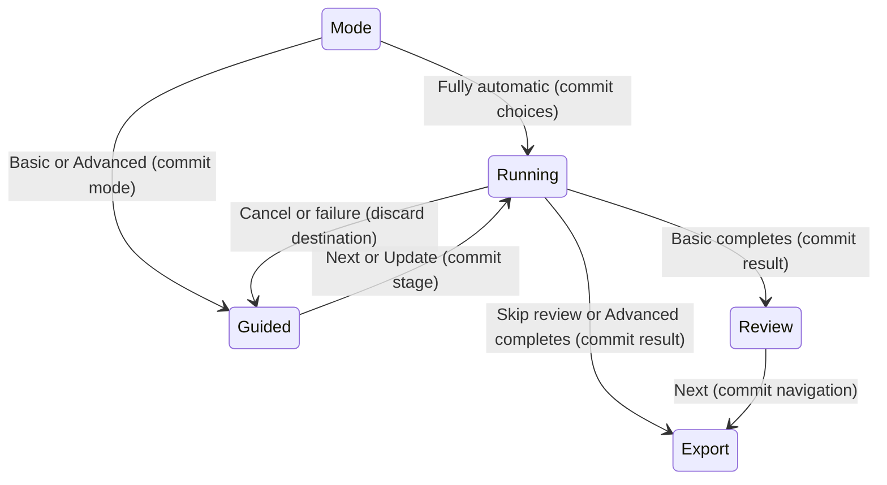

# Conversion

## Summary

Conversion computes vector shapes from the loaded source. Fully automatic is the
shortest route. Basic asks broad questions; Advanced exposes processing stages.

## The simple case

Load a source, choose Fully automatic, wait for Review, inspect the vector result,
then choose Next to reach Export. Saving the result is a separate action.

## The interaction, event by event

### Starting

A source must be loaded. A large image can offer a recommended working size.
Choose a mode after deciding that size. Basic can analyze the source to recommend
settings; Advanced exposes palette and processing choices.

### Ending at once

Changing a mode page does not itself save an output. An unavailable worker reports
an error. A clean navigation step can simply show the next page.

### Becoming extended

Fully automatic or a required stage update starts worker processing. Progress
appears in the footer with Cancel. Navigation waits where completion is required.

### While extended

Most document controls are disabled. View inspection remains possible. Cancel
requests stopping and drops queued navigation. Advanced Auto-update schedules
processing after the delay defined in the input foundation.

### Finishing

The acknowledged result and destination page appear together. Basic normally
lands on Review. Advanced and Skip review land on Export. A result is not saved
until an export succeeds. Failed or canceled work must not claim successful output.

## Modifiers

| Variant | Set at the start | Changed while extended |
| --- | --- | --- |
| Fully automatic | The app selects processing settings. | Document-changing controls are disabled. |
| Basic | Image type, quality and color choices guide fitting. | Worker completion controls navigation. |
| Advanced | Palette, segmentation and smoothing controls are exposed. | Auto-update and manual Update share stage completion. |
| Transparency | The source may add a background choice. | Accepted source preparation is owned by the worker. |
| Skip review | Completion goes directly to Export. | It does not save a file automatically. |

## Cancel and interrupt

| Event | Before extended | While extended |
| --- | --- | --- |
| Explicit cancel | Leave a confirmation without accepting it. | Cancel drops queued work and requests stopping. |
| Another command | Choose settings or a page. | Busy guards prevent conflicting document changes. |
| Focus or process loss | No automatic conversion on focus changes. | Focus loss need not stop processing; process exit loses in-memory work. |
| Target changes outside the app | The loaded source is already in memory. | Source-file changes do not rewrite the loaded pixels. |
| Input device or modifier changes | Modes can be selected with normal controls. | No change to worker parameters already submitted. |

## Interactions with other systems

**Files and permissions.** Conversion itself does not write the source or an export.

**History and undo.** Completed eligible basic settings can enter recent settings.
Recomputing customized palettes or applied edits can require confirmation.

**Busy and modal states.** Worker acknowledgement is required before queued pages
appear. A confirmation must be accepted before destructive recomputation.

**Offline operation.** The local engine performs conversion without a service.

**Feedback.** Progress, page title and the displayed result distinguish loading,
processing and completion. Verify actionable guidance at each step.

**Preferences.** Mode and processing choices can persist. QA uses fresh preferences
and separately checks restart behavior.

## Edge cases

- Transparent and large sources add choices to the common path.
- Changed advanced controls can make Next become Update and Back become Revert.
- A fixed palette adds a choice before the result.
- Recalculation can replace manual colors or edits and must explain that effect.

## Open questions and verification

Run automatic, Basic and Advanced E2E paths. Test cancellation, repeated conversion,
large input, corrupt input and export after failure. Avoid claiming all input
combinations or exact parity from these representative workflows.

Source reviewed: `vector-magic-re` commit `e794628c8ea3fbcfd4903e55c95ac29894846715`. Runtime verification pending.
