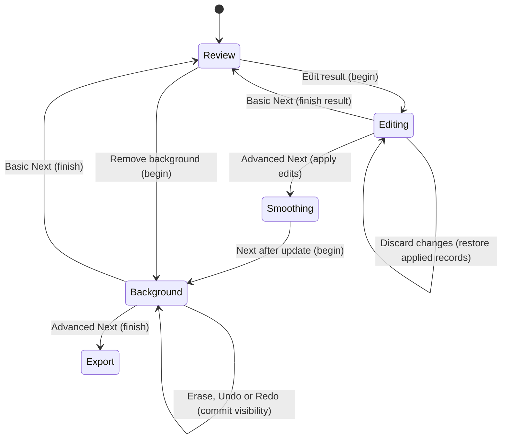

# Editing

## Summary

Editing changes the palette, colored regions or background visibility before export.
The Palette, Segmentation, Editing and Background pages live in the right panel.
Review also offers Edit result and Remove background. The selected tool is marked
in the panel. Editing commands are unavailable while processing runs.

## The simple case

After automatic conversion, choose Edit result on Review. Choose Paint color,
enter red, green and blue values, and accept. Select Fill and click a region.
The segmentation changes to the paint color. Use Undo to restore it or Next to
compute the edited result and return to Review. Choose Remove background, then
click a region with Erase to hide it. Next retains its visibility and returns to
Review. Export writes the result separately, as described in Export.

## The interaction, event by event

### Starting

Advanced conversion reaches Palette first. It offers analyzed candidate palettes,
individual swatches, Add color, Delete last, Revert palette and Source colors.
Click a swatch to edit its red, green, blue and alpha channels. Values are integers
from 0 to 255. Its dialog also offers source-image color picking and deletion.
Canceling the dialog leaves that color unchanged.

Segmentation offers Complexity, Minimum pixels per region, artifact rejection and
Cluster colors. Editing begins after segmentation is current. Review's Edit
result enters Editing directly. The viewer shows segmentation when editing begins.
Remove background begins Background with Erase selected and the vector layer shown.

### Ending at once

Changing the paint color or opacity changes the next edit's color, not the pixels
already painted. Opacity accepts a value from 0 to 1. Invalid values leave the
form open with an error. Pan only moves the view. A Fill click on an already
matching region adds no history record. An out-of-image click changes no pixels.

### Becoming extended

Pencil starts painting on a held left press and continues between pointer samples.
Fill changes the connected region with the exact displayed color at the click.
Zap replaces that connected region with neighboring colors chosen against the
source image. Pick color samples the segmentation on release, then restores the
previous tool. Background Erase toggles a region on press; dragging does not erase
every crossed region.

### While extended

The viewer updates as queued gestures complete. A Pencil drag can create several
Undo records, one for each changed sample, rather than one for the whole stroke.
Shift temporarily switches the selected editing tool to Pan. Holding B or V
changes the displayed layer as described in Inspection. Sampling queued behind
another gesture is retained. Samples cannot cross queued processing or navigation.

Advanced Palette, Segmentation and Smoothing can update automatically; the shared
scheduling behavior belongs to [Input](../foundations/input.md). With Auto-update
off, Update processes changed settings without advancing. Next advances only
when the current page is up to date. Reprocessing that would replace committed
segmentation edits asks for confirmation. Canceling keeps those edits.

### Finishing

Undo and Redo operate on the active editor's records. A new edit clears Redo.
The Editing panel's Undo all resets all current editing records and makes them
available to Redo. The footer's Discard changes restores the committed editing state and
stays on Editing; it is a different operation from the panel's Undo all.

Basic Next finishes vector computation before returning to Review. Advanced Next
applies edits and proceeds to Smoothing, where vector computation may still need
Update. Background Next retains hidden regions, ends Erase and moves to Review
or Export according to mode. Background Back also finishes the visibility edits;
it does not cancel them. Background Undo all restores all regions and retains a
Redo sequence. A later vector recomputation resets background visibility.

## Modifiers

| Variant | Set at the start | Changed while extended |
| --- | --- | --- |
| Basic mode | Enter through Review's Edit result or Remove background. | Next finishes and returns to Review. |
| Advanced mode | Palette and Segmentation precede Editing. | Next applies edits before Smoothing and Background. |
| Tool | Choose Pan, Pencil, Fill, Zap or Pick color; Background offers Pan and Erase. | Choosing the active editing tool again returns to Pan. |
| Shift | Temporarily selects Pan. | Releasing Shift restores the previous tool. |
| B or V | Temporarily shows the available bitmap or vector layer. | Release restores the selected layer; see Inspection. |
| Paint color and opacity | Set the color used by Pencil and Fill. | Existing edited pixels do not change. |
| Auto-update | Relevant Advanced pages may process changes automatically. | Turning it off leaves an explicit Update path. |
| Keyboard | Ctrl+Z undoes; Ctrl+Y or Ctrl+Shift+Z redoes on Editing or Background. | Processing guards still apply. |

## Cancel and interrupt

| Event | Before extended | While extended |
| --- | --- | --- |
| Explicit cancel | Color-dialog Cancel discards the unaccepted color; Escape ends source picking. | Worker Cancel drops queued navigation and waits for acknowledgement; it does not promise to undo completed samples. |
| Another command | Tool and page determine the target of the next click. | Modal dialogs and queued processing block new editing samples; already queued gestures finish in order. |
| Focus or process loss | Focus loss does not save edits. | Process exit loses in-memory edits. Missed button release and held Shift recovery need runtime checks. |
| Target changes outside the app | Source pixels already loaded remain the editing input. | Changing the source file on disk does not itself change the loaded segmentation. |
| Input device or modifier changes | Shift selects temporary Pan; pointer selects a tool. | Shift release restores the tool. A left release outside the viewport is handled; Pencil re-entry needs runtime verification. |

## Interactions with other systems

**Files and permissions.** These commands change the in-memory document. They do
not rewrite the source image or export a file.

**History and undo.** Editing and Background have separate histories. Changing a
paint color does not itself create a pixel edit. Pencil Undo can remove only part
of a stroke.

**Busy and modal states.** Processing disables conflicting commands. Gestures can
queue behind gestures, but cannot queue across a processing boundary. Dialogs
block ordinary controls.

**Offline operation.** Palette, segmentation and background editing run locally.

**Feedback.** Selected tools, paint color, opacity and Undo/Redo availability show
the current editing state. Errors appear in the footer.

**Preferences.** Palette and processing choices persist separately from source
pixels. The document has no editable project save workflow; see
[Document](../foundations/document.md).

## Edge cases

- The public Add color control stops at 24 colors. Deletion may leave an empty palette.
- Zap on a uniform image with no neighboring color reports an error.
- Pick color reads segmentation; the palette dialog's picker reads the source.
- Background Erase toggles visibility. Clicking the same region again restores it.
- Background removal follows vector contour hit testing, including holes.
- Undo all and Discard changes have distinct scopes, as described above.
- Re-entering Editing after applying changes can rebuild its baseline and clear history.
- Recomputing vectors restores background regions; verify the warning and recovery path.

## Open questions and verification

### Static findings for parent triage

- Zap's uniform-region error now says: "This region has no neighboring color.
  Use Fill to change its color." Tooltips explain the editing tools.
- Native QA showed the two old Revert labels together after Fill. The current
  source names the history reset Undo all and the applied-state restore Discard
  changes. Behavior is unchanged.
- Pencil still commits pointer samples separately. A stroke-level Undo contract
  has not been introduced.

### Runtime questions

- Windows candidate `ad58ddf6` entered Editing from Review. Fill enabled Undo;
  Undo enabled Redo; Redo restored the edited history state.
- Candidate `4dd84e10` showed the replacement warning after leaving Editing. The
  test canceled that warning. The focused GPUI test also checks retention.
- Check tool discovery, minimum-size editing layout and keyboard-only completion.
- Check background removal in exported output, including nested contours.
- Source picker cancellation, Shift interruption and Pencil release outside the
  window still need native checks. GPUI window-deactivation checks pass for B/V.

The initial review used commit `e794628c8ea3fbcfd4903e55c95ac29894846715`.
This document includes subsequent GUI fixes; untested native outcomes remain
explicit in [verification](../verification/editing.md).
