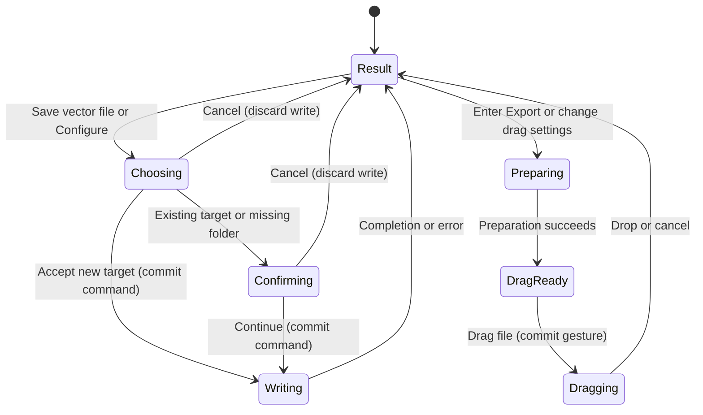

# Export a result

## Summary

Export writes the computed result as a vector file or a rendered bitmap. The Export
page offers Save vector file, Quick Save, Bitmap export and Drag result. Opening a
source alone does not enable vector export. See [The document](../foundations/document.md)
for the difference between a result and a saved file.

## The simple case

Convert an image, continue from Review to Export, select SVG and choose Save vector
file. Accept a new destination in the native chooser. Wait for completion and check
the saved SVG. The current document stays open on Export.

## The interaction, event by event

### Starting

Save vector file opens a native chooser with the source directory and source name
plus the selected vector extension. Vector formats are AI, DXF, EMF, EPS, PDF and
SVG. Shape mode offers Stacked, Cut out and Grouped cutouts. DXF adds Splines,
Sparse lines and Dense lines. EPS adds Compact EPS. Thin outline is also available.

Expand Quick Save or Bitmap export to see its destination and Configure and Save
controls. Configure opens a form with format, directory and filename. Bitmap export
also offers width, height, percent, scale presets and Use view scale. Width and
height stay linked to the source aspect ratio. Its formats are BMP, JPG, PNG and TIF.

Drag result has its own vector format selection and Minimize on drag choice.
Entering Export prepares a temporary vector file before Drag [format] file becomes
available. Preparation failure offers Retry preparation.

### Ending at once

Canceling the native chooser writes nothing. Closing Configure writes nothing,
but retains its directory, filename and format choices. An empty filename produces
an error. A destination that identifies the source file is rejected, including a
source alias. No overwrite confirmation can authorize replacing the source.

### Becoming extended

Accepting Save captures the target and export options. An existing target requires
Replace confirmation. A missing directory requires Create directory confirmation.
Continue accepts that action. Saving then starts worker processing. Quick Save's
Save uses its configured destination without a native chooser, with the same checks.

For transparent output with no selected background, non-PNG bitmap export requires
Confirm flattening transparency. Changing format or reopening Configure clears that
confirmation. PNG does not require flattening confirmation.

### While extended

The footer reports processing. Conflicting commands are unavailable during the
write. Cancel requests worker cancellation; it does not promise to restore a
previously written target. Dragging offers a prepared file to the receiving app.
Minimize on drag minimizes OpenVector when the system drag starts. Ordinary app
commands are blocked during the active drag.

### Finishing

Completion leaves the result available for another export. A save failure appears
in the footer. Export does not create an Undo step or save an editable project.
The receiving app determines what happens to a dropped file. The footer distinguishes
Vector file dropped, Drag cancelled and drag errors. A successful drop does not
prove that the receiver imported the vectors correctly.

## Modifiers

| Variant | Set at the start | Changed while extended |
| --- | --- | --- |
| Basic or Advanced | Quick Save, bitmap and drag choices are separate for each mode. | Accepted save options stay with the command. |
| Main save, Quick Save or drag | Each selects its own vector format. | A queued write retains its options. |
| Bitmap size | Apply width, height or percent; presets and Use view scale set scale. | Writing uses the captured scale. |
| Transparency | Non-PNG can require explicit flattening confirmation. | Format changes clear confirmation before submission. |
| Existing destination | Replace confirmation is required. | External destination changes need verification. |
| Missing directory | Create directory confirmation is required. | Continue creates the directory before retrying the save checks. |
| Keyboard | Enter in a bitmap size field applies that dimension. Enter in a confirmation dismisses it. | Native chooser and system drag keys follow the platform. |
| Batch | Batch export has its own queue and conflict policy. | See [Batch](../batch.md). |

## Cancel and interrupt

| Event | Before extended | While extended |
| --- | --- | --- |
| Explicit cancel | Dismiss the chooser or form without writing; form choices can persist. | Cancel requests worker cancellation. Escape cancels an internal drag; a system drag reports its outcome. |
| Another command | Custom modals block ordinary commands. | Busy writes and active drags block conflicting commands. |
| Focus or process loss | Losing focus does not accept a destination. | Process exit can interrupt writes; the receiver may already hold a drag path. |
| Target changes outside the app | The save checks inspect the selected target. | A changed destination or permission can cause failure; race behavior needs verification. |
| Input device or modifier changes | Native chooser input can use keyboard or pointer. | A handed-off drag follows system input behavior. |

## Interactions with other systems

**Files and permissions.** Output needs a writable destination. Source identity
checks protect the loaded source. Drag result writes a temporary file even when
no permanent Save was requested.

**History and undo.** Saving and dragging do not add editing Undo steps. An exported
file exists independently of subsequent in-memory edits.

**Busy and modal states.** Saving requires a computed result and an idle worker.
Confirmation dialogs require Continue; Enter dismisses them to avoid accidental replacement.

**Offline operation.** Export and drag preparation are local. A receiving app can
have its own requirements.

**Feedback.** The selected format, destination, footer and drag readiness communicate
state. Check the actual output file before treating the workflow as verified.

**Preferences.** Vector options and separate Basic/Advanced save choices persist.
Filenames follow the next loaded source. A new source resets save directories to
its directory. Flattening confirmation does not persist across Configure openings.

## Edge cases

- Bitmap dimensions settle within 1 to 10000 pixels; impossible aspect ratios report an error.
- Quick Save and Bitmap export preserve intermediate dots. A recognized final output suffix selects the format; source suggestions remove the input suffix once.
- An extension typed into the filename can select a supported format.
- Main Save suggests a format extension, but actual vector format follows the accepted destination extension. Verify misleading extensions and missing extensions.
- Source hard links and symbolic links must remain protected.
- Canceling a write must not be described as an atomic rollback without evidence.
- Basic and Advanced keep separate bitmap dimensions. Saving uses the current mode's displayed scale; a focused controller test covers switching modes before saving.
- Changing result geometry or export options invalidates the prepared drag file.

## Open questions and verification

- Run [the export checklist](../verification/export.md) on the isolated Windows instance.
- Confirm output readability in a real vector and bitmap receiver.
- Verify native overwrite prompts, custom confirmation focus and cancellation.
- Filename truncation and cross-mode bitmap scale mismatch are fixed in the current source. See the checklist for remaining native checks.
- Check every export control remains reachable at minimum window size.

Source reviewed: `vector-magic-re` commit `e794628c8ea3fbcfd4903e55c95ac29894846715`. Runtime verification pending.
