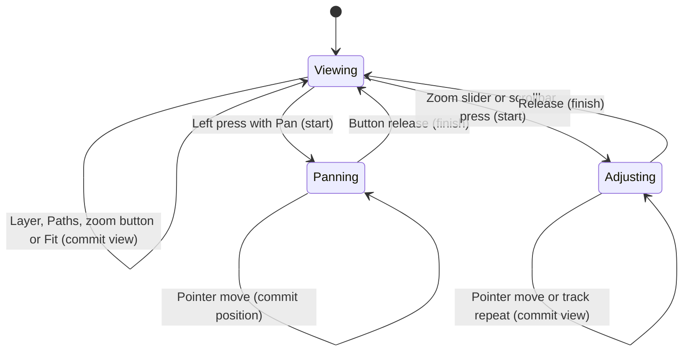

# The image inspection controls

## Summary

Inspection changes the visible layer, magnification and image position without changing the source or result. The viewer occupies the left side of the single-image workspace. Its narrow tool strip contains pan arrows, zoom controls, 100%, Fit, Bitmap, Regions, Vector and Paths. A percentage appears inside the viewer. Layer controls need their corresponding source, segmentation or result. View controls remain available during processing when a document exists.

## The simple case

After conversion reaches Review, inspect the Vector layer. Scroll over the image to zoom around the pointer. Drag the image with the left button to pan. Choose Bitmap to compare the source, then Vector to return to the result. Choose Fit to center the image within the available area. Inspection writes no output file.

## The interaction, event by event

### Starting

Click the image to give the viewer keyboard focus. With Pan active, a left press starts panning immediately. On editing pages, hold Shift to use Pan temporarily. A scrollbar thumb press remembers the grab position; a track press moves one page toward the pointer. Pressing the zoom slider sets its position immediately.

### Ending at once

A pan press and release without movement leaves the view in place. Bitmap, Regions and Vector select their corresponding layers. Unavailable layers have disabled controls. Paths toggles black outlines on the filled vector shapes and has no visible effect while Bitmap or Segmentation is selected. Fit and 100% recenter the image; 100% uses the source dimensions.

### Becoming extended

Movement after a pan press changes the image position without a drag threshold. Moving a grabbed scrollbar thumb changes only that axis. Holding a scrollbar track press repeats paging after the delay owned by [Input](../foundations/input.md), then stops when the thumb reaches the pointer. Holding B or V temporarily displays that available layer.

### While extended

Panning, zoom-slider movement and scrollbar movement update the view as input arrives. Scrollbars clamp at their ends. Moving a grabbed scrollbar away from its track still controls that scrollbar and does not paint the image. The mouse wheel zooms rather than scrolling vertically. Horizontal wheel movement alone does not pan. The percentage reports the displayed magnification.

### Finishing

Releasing a pan ends movement and retains the last position. Any button release ends an image pan. Releasing the left button ends scrollbar or zoom-slider adjustment, including an outside release handler. There is no inspection Undo record. Releasing B or V returns to the selected layer when neither comparison key remains held. A page transition selects the page's default layer and tool.

## Modifiers

| Variant | Set at the start | Changed while extended |
| --- | --- | --- |
| Pan active | Left drag pans. | Any button release ends the pan. |
| Editing tool active | Ordinary left input belongs to [Editing](editing.md). | Shift temporarily selects Pan; release restores the tool. Changing Shift during a live edit needs verification. |
| Hold B | Shows Bitmap if a source exists. | Release returns to the selected layer when no comparison key remains held. |
| Hold V | Shows Vector if a result exists. | Release returns to the selected layer when no comparison key remains held. |
| B and V together | The latest key press chooses its layer. | Overlapping keys and unrelated key presses need verification; this is not a stack of held keys. |
| Viewer keyboard focus | Arrow keys move the image position; Alt+Left/Right navigate pages. | Focus moving to another control changes which keys it consumes. |
| Zoom-slider focus | Arrows adjust one position; Page Up/Down adjust a larger step; Home/End select the limits. | No effect from a pointer modifier. |
| Scrollbar focus | Arrows step its axis; Page Up/Down page; Home/End select its limits. | These keys stay with the scrollbar rather than navigating pages. |
| Processing | Existing layer and view controls remain usable. | Completion can change the page and its selected layer. |

## Cancel and interrupt

| Event | Before extended | While extended |
| --- | --- | --- |
| Explicit cancel | Inspection has no pending document change. | Escape has no general pan or zoom rollback; release ends the gesture and keeps the view. |
| Another command | A layer or view command applies immediately. | Fit, modal entry, batch entry and source replacement clear scrollbar ownership. Processing completion can select another layer. Image-pan ownership across other commands needs runtime verification. |
| Focus or process loss | Focus determines key routing. | Scrollbar repeat continues after keyboard deactivation until release in the existing test. Window deactivation releases comparison keys and temporary Shift-to-pan state. Process exit loses the view. |
| Target changes outside the app | No effect on the loaded view. | No effect on in-memory source or result; inspection does not reread the source file. |
| Input device or modifier changes | Pointer and focused keyboard controls can change the same view. | Missing left-button state ends scrollbar ownership; no held button ends pan on the next move. Shift changes the active tool. Wheel input clears scrollbar ownership. |

## Interactions with other systems

**Files and permissions.** Inspection needs no additional disk permissions and does not change the source or exported files.

**History and undo.** View changes do not enter editing history. Undo belongs to document edits.

**Busy and modal states.** View controls remain enabled with a document during processing. Custom dialogs disable ordinary view buttons and scrollbar presses. Check that wheel input cannot reach the viewer behind a dialog.

**Offline operation.** Inspection uses the loaded source and computed geometry locally.

**Feedback.** Layer buttons show the visible layer. Pan and zoom icons have accessible names. Visible layer names and hover help explain layer selection and temporary B/V comparison. The zoom percentage remains visible over the lower-right image area.

**Preferences.** Inspection controls do not persist view settings. Bitmap export's Use view scale reads the current zoom setting; export owns that behavior.

## Edge cases

- Fit enlarges small images and limits magnification to the supported zoom range. A sufficiently large image can remain clipped even after Fit.
- Resizing retains the view center; it does not automatically fit again after the initial measurement.
- Selecting an unavailable layer programmatically falls back to Bitmap. Ordinary buttons prevent this selection.
- Segmentation and Editing default to Segmentation. Smoothing, Background, Review and Export default to Vector where available.
- Paths stays selected when switching to Bitmap, and reappears on returning to Vector.
- Background can display dashed outlines for removed regions. Editing owns removal behavior.
- At the minimum window size, the tool strip can scroll vertically. Verify that Fit and all layer controls remain reachable without hiding the image entirely.
- The reserved scrollbar corner must not start image panning or zooming; existing input tests cover this boundary.

## Open questions and verification

- Native checks remain in [the inspection checklist](../verification/inspection.md).
  Twelve focused GPUI input tests pass, including button/key pan parity, window
  deactivation, scrollbar ownership and source-replacement confirmation.
- The released vertical pan-button mismatch was reproduced on Windows and is
  corrected in current source. Verify the rebuilt candidate on Windows.
- The stuck B/V state was reproduced through GPUI window deactivation. The new
  observer releases temporary keys while preserving the selected layer and tool.
  Native application-switching verification remains pending.
- Verify Windows wheel behavior, keyboard focus, minimum-size layout,
  transparent-image visibility and readable Paths outlines on dark artwork.

The initial source review used commit
`e794628c8ea3fbcfd4903e55c95ac29894846715`; this document now describes the GUI
usability changes. Runtime receipts and exact candidate hashes are recorded in
[verification](../verification/README.md). Source tests do not replace native checks.
