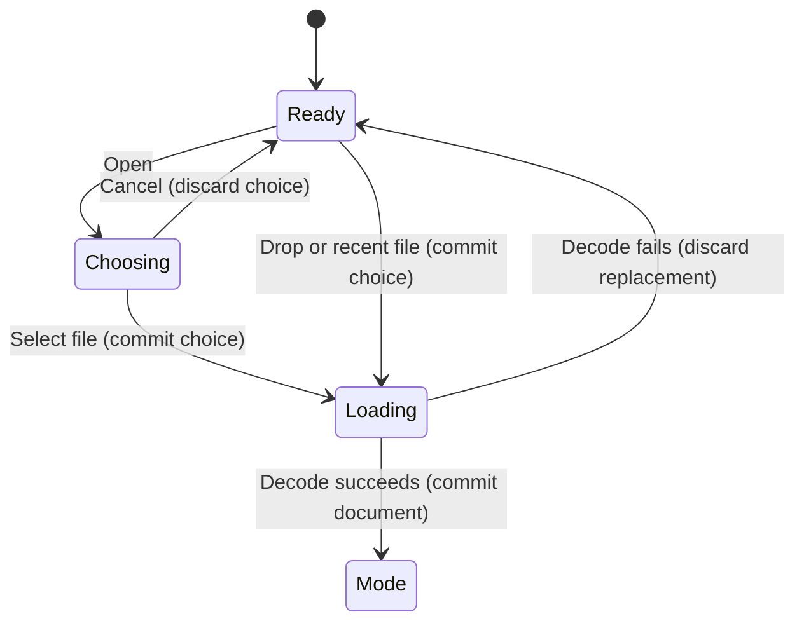

# Open an image

## Summary

Opening loads a source image for conversion. It does not trace the image yet.
The Open control lives in the top toolbar. Browse images also appears on the
Load image page. A file can be dropped into the app or selected from recent files.
The current file name and dimensions appear in the toolbar after a successful load.
Open is unavailable while the worker is running.

## The simple case

Choose Open, select an image and accept the file dialog. Wait for loading to finish.
The image appears in the viewer and the wizard shows the mode page. Choose Fully
automatic to continue with the shortest conversion path.
The source file is unchanged. No vector output is saved by this action.

## The interaction, event by event

### Starting

Open and Browse images open a native file dialog. Single-image selection accepts
one file. The batch Add files control is a different interaction owned by Batch.
A recent entry or dropped path can start loading without the file dialog.
The previous document remains until a replacement has loaded successfully.

### Ending at once

Canceling the file dialog leaves the current image and page in place.
A file-dialog error appears in the footer. No output file is created.
Invoking Open while processing is unavailable.
An empty file selection does not change the document.

### Becoming extended

Accepting a path starts loading. The footer shows processing feedback.
Controls that would change the document are unavailable while loading.
The source path is resolved before the worker reads it.
The previous image can still be visible during this interval.

### While extended

Cancel requests that the worker stop. Completion acknowledges the request.
The view can still be inspected with view-only controls where available.
No source bytes are changed. No vector export occurs as part of loading.
If the source is large, successful loading can offer a reduced working size on
the mode page. The size decision belongs to Conversion.

### Finishing

On success, the new source replaces the document, the viewer fits the image and
the mode page appears. Recent-file history records successful path loads.
The old result cannot be exported as though it belonged to the new source.
On failure, the previous image, document state and export eligibility remain.
This preservation is intentional and is required by the current product contract.

## Modifiers

| Variant | Set at the start | Changed while extended |
| --- | --- | --- |
| Empty document | Success creates the first document. | The accepted source becomes current on completion. |
| Existing document | Success replaces it; failure preserves it. | Loading owns the pending replacement. |
| Recent file | Loads the selected stored path. | The disk read can fail if the file is missing. |
| File drop | Uses the first path in single-image mode. | Additional dropped files are not a batch conversion. |
| Batch mode | Add files belongs to the batch queue. | See Batch for queue behavior. |
| Keyboard modifiers | No documented alternate decoding behavior. | No effect on accepted file bytes. |

## Cancel and interrupt

| Event | Before extended | While extended |
| --- | --- | --- |
| Explicit cancel | Native dialog Cancel keeps the current document. | Worker cancellation is requested; verify the retained document after acknowledgement. |
| Another command | Modal file selection owns the native dialog interaction. | Document-changing actions are blocked while loading. |
| Focus or process loss | Losing focus does not accept a file. | Focus loss is not a save; process exit loses unsaved in-memory work. |
| Target changes outside the app | The chosen path may no longer exist. | The read may fail; successful decode becomes the loaded source. |
| Input device or modifier changes | Selection can use the native dialog's keyboard or pointer controls. | No effect on an already accepted source path. |

## Interactions with other systems

**Files and permissions.** Loading needs readable input. Permission and decoder
errors must remain visible without overwriting the input.

**History and undo.** Successful loads enter recent-file history. Loading a new
source is not a segmentation Undo step.

**Busy and modal states.** Open is disabled during processing. A custom modal
blocks ordinary controls. Native chooser behavior needs runtime verification.

**Offline operation.** Loading and decoding are local. No account or service is needed.

**Feedback.** File name and dimensions identify the accepted source. The footer
reports errors and processing. No successful conversion is implied by loading.

**Preferences.** Recent-file entries and source directory persist separately from
source bytes. The QA instance uses its own preferences file.

## Edge cases

- A missing recent file must report the problem and retain the current document.
- A corrupt image must not replace a working result.
- A transparent source may add a Transparency page to guided conversion.
- A large source may offer a smaller working size before conversion.
- A drop containing several files uses the first in single-image mode.
- A file with spaces or non-ASCII characters needs an actual load check.
- Repeated Open commands while loading must not queue accidental replacements.
- Unsaved segmentation/background edits need clear replacement behavior.
- Paste image has a separate replacement confirmation; consistency with Open
  is a suspected usability defect until the replacement paths are checked.

## Open questions and verification

- Confirm native file dialog cancellation and focus return on Windows.
- Confirm missing/corrupt file errors preserve a previously computed result.
- Check whether Open warns before discarding edits as Paste already does.
- Check the discoverability of the first action in the empty window.
- Check keyboard access to Open and all mode choices.

Source reviewed: `vector-magic-re` commit `e794628c8ea3fbcfd4903e55c95ac29894846715`. Runtime verification pending.
